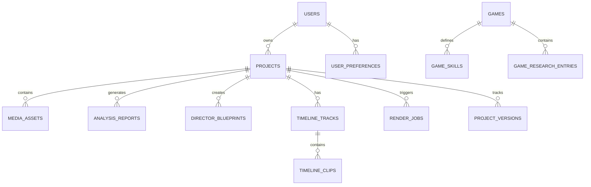

# NEURAL CUT AI — DATABASE SCHEMA SPECIFICATION
**Version:** 1.0.0  
**Target:** Relational (PostgreSQL / SQLite)  

---

## 1. Entity-Relationship Diagram

---

## 2. Table Definitions

### 2.1 `users`
- `id` (UUID, Primary Key)
- `email` (VARCHAR(255), Unique, Indexed)
- `hashed_password` (VARCHAR(255))
- `full_name` (VARCHAR(150))
- `created_at` (TIMESTAMP WITH TIME ZONE)
- `updated_at` (TIMESTAMP WITH TIME ZONE)

### 2.2 `user_preferences`
- `user_id` (UUID, Foreign Key -> users.id, Primary Key)
- `editing_style` (VARCHAR(50), Default: 'AMV / Anime Style')
- `default_platform` (VARCHAR(50), Default: 'Multiple Platforms')
- `default_duration` (INTEGER, Default: 60)
- `default_aspect_ratio` (VARCHAR(20), Default: 'Auto')
- `default_subtitle_mode` (VARCHAR(50), Default: 'Animated Subtitles')
- `effect_intensity` (FLOAT, Default: 1.0) # 100%
- `creative_freedom` (VARCHAR(20), Default: 'High')
- `music_selection` (VARCHAR(50), Default: 'AI Recommended')
- `color_grading_preset` (VARCHAR(50), Default: 'Cinematic')

### 2.3 `projects`
- `id` (UUID, Primary Key)
- `user_id` (UUID, Foreign Key -> users.id)
- `name` (VARCHAR(255))
- `category` (VARCHAR(50)) # 'Gaming Montage', 'AMV', 'Cinematic', etc.
- `aspect_ratio` (VARCHAR(20)) # '16:9', '9:16', '1:1'
- `duration` (FLOAT)
- `status` (VARCHAR(30)) # 'draft', 'analyzing', 'editing', 'rendered'
- `is_archived` (BOOLEAN, Default: FALSE)
- `created_at` (TIMESTAMP WITH TIME ZONE)
- `updated_at` (TIMESTAMP WITH TIME ZONE)

### 2.4 `media_assets`
- `id` (UUID, Primary Key)
- `project_id` (UUID, Foreign Key -> projects.id)
- `original_filename` (VARCHAR(255))
- `file_path` (VARCHAR(500))
- `proxy_path` (VARCHAR(500))
- `thumbnail_path` (VARCHAR(500))
- `file_size_bytes` (BIGINT)
- `duration_seconds` (FLOAT)
- `width` (INTEGER)
- `height` (INTEGER)
- `fps` (FLOAT)
- `codec` (VARCHAR(50))
- `audio_sample_rate` (INTEGER)
- `created_at` (TIMESTAMP WITH TIME ZONE)

### 2.5 `analysis_reports`
- `id` (UUID, Primary Key)
- `media_asset_id` (UUID, Foreign Key -> media_assets.id)
- `detected_scenes_json` (JSONB) # array of {startTime, endTime, luminance, motionScore, tags}
- `highlight_moments_json` (JSONB) # array of {timestamp, score, reason, effect}
- `audio_beats_json` (JSONB) # array of beat timestamps & BPM
- `confidence_score` (FLOAT)
- `created_at` (TIMESTAMP WITH TIME ZONE)

### 2.6 `game_knowledge_entries`
- `id` (UUID, Primary Key)
- `game_name` (VARCHAR(150), Indexed) # e.g. 'Roblox Gakuran', 'Apex Legends'
- `genre` (VARCHAR(100)) # 'Anime Fighting', 'Battle Royale'
- `mechanics_summary` (TEXT)
- `combo_system_details` (TEXT)
- `counter_mechanics` (TEXT)
- `verified_source` (VARCHAR(255))
- `is_verified` (BOOLEAN, Default: TRUE)
- `last_updated` (TIMESTAMP WITH TIME ZONE)

### 2.7 `timeline_tracks` & `timeline_clips`
- `track_id` (VARCHAR(50), Primary Key)
- `project_id` (UUID, Foreign Key -> projects.id)
- `type` (VARCHAR(20)) # 'video', 'text', 'audio'
- `name` (VARCHAR(100))
- `order_index` (INTEGER)
- `is_muted` (BOOLEAN)
- `is_locked` (BOOLEAN)
- `is_hidden` (BOOLEAN)
- `volume` (FLOAT)

### 2.8 `render_jobs`
- `id` (UUID, Primary Key)
- `project_id` (UUID, Foreign Key -> projects.id)
- `resolution` (VARCHAR(20)) # '1080p', '4k', '720p'
- `format` (VARCHAR(20)) # 'mp4', 'webm'
- `status` (VARCHAR(30)) # 'queued', 'processing', 'completed', 'failed'
- `progress_percent` (FLOAT)
- `current_stage` (VARCHAR(100))
- `output_file_path` (VARCHAR(500))
- `error_message` (TEXT)
- `started_at` (TIMESTAMP WITH TIME ZONE)
- `completed_at` (TIMESTAMP WITH TIME ZONE)
