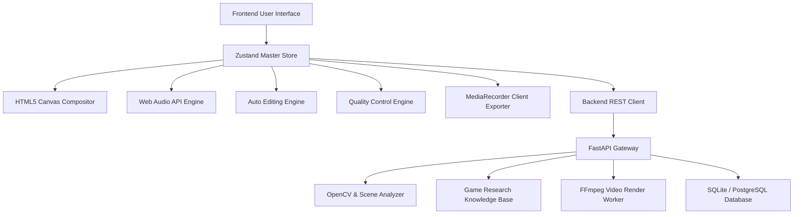

# NEURAL CUT AI — MODULE DEPENDENCIES & CONTRACTS
**Version:** 1.0.0  

---

### Module Contracts

1. **Analysis Output Contract (`VideoAnalysisReport`):**
   - Must provide `scenes` array where each scene contains `startTime`, `endTime`, `motionIntensity`, `actionScore`, and `tags`.
   - Must provide `highlights` array with `confidence`, `reason`, and `recommendedEffect`.
   - Must guarantee strictly continuous, non-overlapping timestamps.

2. **Director Blueprint Contract (`DirectorConcept`):**
   - Must emit `plannedCuts` array conforming to timeline stages: `HOOK_OPENING`, `BUILD_UP`, `CLIMAX`, `RESOLUTION_OUTRO`.
   - Must target exactly 45–60 seconds for AMV / Gaming montage profiles unless overridden by user preferences.

3. **Timeline State Contract (`EditorStoreState`):**
   - Modifying clips or tracks must immediately emit canvas redraw requests to `VideoCompositor`.
   - History stack pushes must execute prior to state mutation to ensure 100% undo/redo fidelity.
